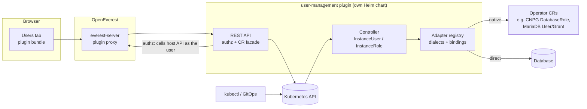

# User Management Plugin

*   **Status:** Draft
*   **Authors:** @spron-in
*   **Created:** 2026-06-17
*   **Last Updated:** 2026-10-25
*   **Related Issues:** openeverest/openeverest#1815
*   **Related specs:** [001 — Modular core / Provider plugins](./001-plugins-architecture.md), [003 — Generic plugins](./003-generic-plugins.md)

---

## 1. Summary

This spec describes a plugin that manages **users and roles of OpenEverest `Instance`s**: accounts inside databases, and API keys for models served by provider-kserve.

It adds two namespaced custom resources, `InstanceUser` and `InstanceRole`, and runs its own controller to reconcile them. It also provides a REST API and a per-instance **Users** tab in the UI. The kinds are named after `Instance`, not after databases, because a user of a model is an API key, not a database account (§4.6).

Users that the operators create by default (superusers, monitoring and replication accounts) are listed as **read-only system users**. The plugin never changes them.

Engine-specific work sits behind two layers:

- a **dialect** for each database technology (PostgreSQL, MySQL, MongoDB, …);
- a **binding** for each provider. The binding is mostly data and records how a given operator should be driven.

Adding a provider for an engine that already has a dialect is a configuration change. Adding a new database technology means one new dialect package. Neither requires changes to the UI or the architecture.

The MVP targets **CloudNativePG, MariaDB and Percona Server for MongoDB**, plus **provider-kserve** for model API keys. It requires **no changes to OpenEverest core or provider-sdk**.

## 2. Motivation

OpenEverest provisions database instances but stops at the instance boundary. To give an application its own least-privilege account today, a user has to:

- `kubectl exec` into a pod and run `CREATE USER` / `db.createUser()` by hand; or
- learn a different, operator-specific surface for each engine. Some operators offer separate CRDs, some an inline list on the cluster CR, and some nothing at all (see §4.6).

None of this is uniform, none of it is visible in the OpenEverest UI, and most operators only cover part of the lifecycle. For example, no Percona operator drops a user that is removed from its `spec.users`.

The `{instance}-conn` Secret makes the problem worse. On some providers it holds the superuser (`postgres`, `root`), so applications end up running as superuser by default.

Models have the same problem. provider-kserve exposes `llm` and `predictor` Instances through the Envoy AI Gateway with **one API key per model**, kept in the Instance's connection Secret. Every application that calls the model shares that key. One consumer can't be revoked without breaking all of them, and token quotas and usage metrics can't tell consumers apart. An API key per consumer is the same thing as a user per application of a database, so it belongs in this plugin rather than in a separate API.

**User stories:**

1. *As a developer*, I open my instance, go to **Users**, click **Create user**, pick "read/write on `orders`", and get a Secret my app can mount.
2. *As a DBA*, I define a `reporting` role once and assign it to several users.
3. *As a platform engineer*, I manage users and roles in Git as CRs, next to the `Instance`.
4. *As an operator of OpenEverest*, I can see which accounts the database operator created and reveal their credentials, but I can't break them by accident.
5. *As an ML platform owner*, I open a model Instance, go to **Users**, and create an API key for each application that calls the model, so I can revoke, rate-limit and meter each one separately.

## 3. Goals & Non-Goals

**Goals:**

* **G1 — Operator-created users are read-only.** They are listed with their purpose, and their credentials can be revealed (RBAC-gated and audited). They are never created, changed, rotated or dropped by the plugin, and their names are reserved.
* **G2 — Create and manage new users and roles.**
  * Use the operator's own facility where it supports the full lifecycle.
  * Connect to the database directly where it doesn't.
  * The choice is made per operation, so one engine can mix both.
* **G3 — Three equivalent surfaces.**
  * **UI:** a Users tab per instance, with a list, a details view and create/edit forms.
  * **REST API:** used by the UI and by external tools.
  * **CRDs:** for kubectl and GitOps.
  * CRs are the single source of truth. The UI and API read and write CRs.
* **G4 — Modular.** Adding a provider or a database technology is additive. The UI renders entirely from a per-instance *capabilities* descriptor and needs no code changes.
* **G5 — Converge.**
  * Deleting a CR removes the account from the database.
  * Spec changes are applied in place.
  * After an instance is restored or recreated, its users are replayed.
* **G6 — No core changes for the MVP.** Everything ships in the plugin's Helm chart.

**Non-Goals:**

* Changing or rotating operator-created (system) users.
* SSO / LDAP / OIDC federation (later phase).
* Row-level security or application-level authorization.
* Managing schema objects (tables, collections). The plugin only grants privileges on them.
* One `InstanceUser` targeting several instances (later phase).
* External secret stores such as Vault or ESO (later phase).
* Zero-downtime password rotation in the MVP (see §4.10).

## 4. Proposed Solution / Design

### 4.1 User experience

**Users tab.** This is a `clusterDetailTab`, filtered by the Provider CR names that have a binding (§4.5).

The list merges three kinds of principals:

| Kind | Source | Badge | Actions |
|---|---|---|---|
| **System** | the binding's `systemUsers` list (§4.5) | `Operator-managed` | View, Reveal credentials |
| **Managed** | `InstanceUser` / `InstanceRole` CRs | status (`Ready`, `Pending`, `Failed`, `Deleting`) | View, Edit, Delete, Reveal credentials, Rotate password |
| **Discovered** *(Phase 2)* | read live from the database | `Unmanaged` | View, Import |

- **Users and Roles** are two sub-lists in the tab. Roles are only shown when the capabilities descriptor says the engine supports them.
- **Details view:**
  - assigned roles and effective privileges (scope and actions);
  - connection info: host, port and URI template, with no password until revealed;
  - credentials Secret name;
  - conditions and recent events.
- **Create user:**
  - username, then password (generate it, or bring your own Secret). On engines whose credential is an API key (§4.6, models), the form says "API key" and always generates it;
  - roles, picked from the instance's `InstanceRole`s plus the engine's built-in roles;
  - privileges, either **presets** (`read`, `readWrite`, `owner` on a database) or **advanced** (engine-native actions at the scopes the engine supports);
  - optional limits.
- **Create role:** name, privileges (same picker as above), and inherited roles where the engine supports them.

**API and CRDs.** Every action in the UI maps to one REST call (§4.8), which creates, updates or deletes one CR. Anything you can do in the UI, you can do with `kubectl apply`.

### 4.2 Architecture



**The plugin chart ships** (as allowed by spec 003 §10.7):

- the `Plugin` CR;
- the CRDs;
- one Deployment running both the controller (controller-runtime manager) and the REST backend;
- a ServiceAccount, plus a ClusterRole and binding;
- an optional ValidatingAdmissionPolicy (§4.12).

**What it does not depend on:**

- spec 003 §10.8 host-managed CRDs or the `/reconcile` callback. The plugin is its own controller.
- the spec 003 event stream. It watches `Instance` and `Restore` directly.

**Plugin Kubernetes RBAC:**

| Scope | Verbs |
|---|---|
| Its own CRs | full access |
| `instances`, `providers`, `restores` | `get` / `list` / `watch` |
| `secrets` | `get` / `list` / `watch` / `create` / `update` / `delete`, needed for credential Secrets and for reading admin credentials |
| Operator user CRs the bindings use (CNPG `databaseroles`, MariaDB `users` / `grants` / `databases`) | create / update / delete |
| Operator CRs a binding writes inline (Phase 2+) | `get` / `patch` |

### 4.3 Principal classes and ownership

- **System users** are defined by the binding (§4.5). The plugin does not create CRs for them.
  - Their names, and any patterns, are added to the binding's `reservedNames`. Webhook/CEL validation rejects an `InstanceUser` or `InstanceRole` that uses one.
  - "Reveal credentials" reads the Secret and key that the binding declares.
- **Managed principals** are created from CRs. The CR is authoritative for the attributes it declares.
- **Discovered principals** (Phase 2) are database accounts that are neither system nor managed. They are listed read-only. **Import** creates a CR with `spec.adopt: true`.
  - Without `adopt`, a CR whose username already exists in the database fails with `Conflict`. The plugin never silently takes over an account.

### 4.4 Custom resources

API group: `users.plugins.openeverest.io/v1alpha1`. Both kinds are namespaced and live in the `Instance`'s namespace.

#### Privilege model

The same privilege block is used inline on users and on roles:

```yaml
privileges:
  # Preset: engine-neutral, translated by the dialect
  - database: orders
    preset: readWrite             # read | readWrite | owner
  # Advanced: engine-native actions at a scope the engine supports
  - database: orders
    schema: reporting             # PostgreSQL only
    # collection: events          # MongoDB only
    # table: invoices             # SQL engines
    actions: [SELECT]
```

The capabilities descriptor (§4.7) lists the valid scopes and actions per engine. The admission webhook validates against it.

#### `InstanceRole`

```yaml
apiVersion: users.plugins.openeverest.io/v1alpha1
kind: InstanceRole
metadata:
  name: reporting
  namespace: team-alpha
spec:
  instanceRef:
    name: orders-pg
  roleName: reporting             # DB-side name; immutable; defaults to metadata.name
  database: admin                 # MongoDB: the DB the role is defined in (default admin)
  privileges:
    - database: orders
      preset: read
  inheritedRoles:                 # other InstanceRoles or engine built-in roles
    - roleRef: { name: base-readonly }
    - builtIn: { name: pg_read_all_stats }
  deletionPolicy: Delete          # Delete | Retain
status:
  phase: Ready
  observedGeneration: 3
  conditions: [...]
```

#### `InstanceUser`

```yaml
apiVersion: users.plugins.openeverest.io/v1alpha1
kind: InstanceUser
metadata:
  name: app-orders
  namespace: team-alpha
spec:
  instanceRef:
    name: orders-pg
  username: app_orders            # DB-side name; immutable; defaults to metadata.name
  authDatabase: admin             # MongoDB only
  passwordSecretRef:              # optional; if absent the plugin generates one
    name: app-orders-password
    key: password
  roles:
    - roleRef: { name: reporting }        # InstanceRole in the same namespace/instance
    - builtIn: { name: read, database: analytics }   # engine built-in role
  privileges:                     # optional inline grants (same model as InstanceRole)
    - database: orders
      preset: readWrite
  limits:
    connectionLimit: 20           # only if the engine supports it
  adopt: false                    # Phase 2: take over an existing DB account
  deletionPolicy: Delete          # Delete | Retain
status:
  phase: Ready                    # Pending | Ready | Failed | Deleting
  observedGeneration: 4
  credentialsSecretRef:
    name: app-orders-credentials
  effectiveRoles: [reporting, read@analytics]
  passwordChangedAt: 2026-10-20T10:00:00Z
  conditions:
    - type: Ready
    - type: CredentialsReady
    - type: DropBlocked           # e.g. PostgreSQL role still owns objects
```

**Rules:**

- `instanceRef` must point to an `Instance` whose Provider has a binding.
- `username` and `roleName` are validated against the binding's pattern and reserved names.
- Fields the engine doesn't support (from the capabilities descriptor) are rejected at admission, not silently ignored.
- **Inline privileges on engines that can't grant directly to a user** (MongoDB) are implemented as a plugin-owned implicit role, `<username>__inline`. The UI hides it, and it is reserved.
- `DatabaseGrant` from earlier drafts is dropped. User→role assignment lives on the user, and role→role inheritance lives on the role. If RBAC-split assignment is needed later, a binding object can be added without changing these kinds.
- **Naming.** Earlier drafts called the kinds `DatabaseUser` and `DatabaseRole`. They are `InstanceUser` and `InstanceRole` because they also cover users of models (API keys), and because `DatabaseRole` clashes with the CloudNativePG kind of the same name, which the CNPG binding writes.

### 4.5 Adapters: dialects and bindings

The plugin keeps *how to talk to an engine* separate from *how a given provider and operator exposes that engine*.

#### Dialect (Go code, one per engine family)

```go
type Dialect interface {
    Name() string                                  // "postgresql", "mysql", "mongodb", …
    Capabilities(engineVersion string) Capabilities // feeds the UI and admission (§4.7)
    Connect(ctx context.Context, ep Endpoint, cred Credentials) (Session, error)
}

// Session is the direct, wire-protocol path. All writes are idempotent and diff-based.
type Session interface {
    EnsureUser(ctx context.Context, u UserSpec) error
    DropUser(ctx context.Context, name string, opts DropOptions) error // PG: REASSIGN/DROP OWNED per DB
    EnsureRole(ctx context.Context, r RoleSpec) error
    DropRole(ctx context.Context, name string) error
    SetMemberships(ctx context.Context, principal string, roles []RoleRef) error
    SetPrivileges(ctx context.Context, principal string, desired []Privilege) error // computes GRANT/REVOKE delta
    ListPrincipals(ctx context.Context) ([]Principal, error)                       // drift + discovery
    Close() error
}
```

Rules for the direct path:

- Always use parameterised statements or strict identifier quoting.
- Never revoke-all-then-grant. Always compute the minimal delta.
- MySQL-family dialects use `RETAIN CURRENT PASSWORD` where available.

#### Binding (per Provider; data plus optional native strategies)

```yaml
# Shipped inside the plugin for the MVP; candidate for Provider.spec.userManagement later (§4.13)
provider: provider-cloudnative-pg          # Provider CR name (also used for the UI tab filter)
dialect: postgresql
minOperatorVersion: "1.30.0"
endpoint:
  host: "{instance}-rw.{namespace}.svc"    # primary, for DDL
  port: 5432
adminCredentials:                          # used by the direct path only
  bootstrap: cnpg-superuser-role           # plugin creates CNPG DatabaseRole "everest_useradmin" (superuser)
systemUsers:
  - name: postgres
    description: Superuser (only if superuser access is enabled)
    secret: { name: "{instance}-superuser", usernameKey: username, passwordKey: password }
  - name: app
    description: Application owner created at bootstrap
    secret: { name: "{instance}-app", usernameKey: username, passwordKey: password }
  - name: streaming_replica
    description: Replication (certificate auth, no password)
reservedNames: [postgres, app, streaming_replica, everest_useradmin, "pg_*", "cnpg_*"]
usernamePattern: '^[a-z_][a-z0-9_]{0,62}$'
strategies:                                # per operation: native:<strategy> | direct
  user: native:cnpg-databaserole           # login role + password Secret + membership
  role: native:cnpg-databaserole           # NOLOGIN role + membership
  privileges: direct                       # GRANT/REVOKE: no operator supports object grants
```

A **native strategy** is a small Go module that maps a `UserSpec` or `RoleSpec` to operator CRs and reads their status back. It must implement the operations its binding routes to it:

```go
type NativeStrategy interface {
    Name() string                    // "cnpg-databaserole", "mariadb-user-grant", …
    EnsureUser(ctx context.Context, inst Instance, u UserSpec) (Result, error)
    DeleteUser(ctx context.Context, inst Instance, name string) (Result, error)
    // optional: EnsureRole / DeleteRole / SetPrivileges
}
```

**What a new technology or provider costs:**

| Change | What's needed |
|---|---|
| New provider for an engine with a dialect, direct only | A binding (YAML). No code, no UI change. |
| New provider whose operator has a usable user CR | A binding plus one native strategy module. |
| New database technology | One dialect package plus a binding. No UI change. |
| Non-database engine whose users are API keys (models) | A binding plus one native strategy that writes the provider's key Secrets. No dialect, no UI change (§4.6). |

### 4.6 Engine support

This section summarises a source-level review of each operator and hands-on tests on OpenEverest 2.0.0-dev.4 (October 2026).

#### MVP bindings

| | **CloudNativePG** (`provider-cloudnative-pg`) | **MariaDB** (`mariadb`) | **Percona Server for MongoDB** (`percona-server-mongodb`) |
|---|---|---|---|
| Users | native `DatabaseRole` (login) | native `User` | direct (`createUser` / `updateUser` / `dropUser`) |
| Roles | native `DatabaseRole` (no login) | direct `CREATE ROLE` / `GRANT role` (operator has no role CRD) | direct `createRole` / `updateRole` |
| Privileges | direct `GRANT` / `REVOKE` | native `Grant` for users; direct for roles | through roles (inline → implicit role) |
| Databases | `owner` preset can use native `Database` | native `Database` when needed | implicit (Mongo creates DBs on write) |
| Admin credentials (direct path) | plugin-created CNPG `DatabaseRole everest_useradmin` with `superuser: true`, because the provider doesn't expose a superuser | operator root: `MariaDB.spec.rootPasswordSecretKeyRef` | `everest-secrets-{instance}`: `MONGODB_USER_ADMIN_USER` / `_PASSWORD` |
| Endpoint | `{instance}-rw` | `{instance}` service (MaxScale passes SQL-created users through) | replica-set URI (hosts from `{instance}-conn`) |
| System users | `postgres`, `app`, `streaming_replica` | `everest` (and its operator-created `User`/`Grant`/`Database` CRs), `root`, `mariadb.sys` | `databaseAdmin`, `userAdmin`, `clusterAdmin`, `clusterMonitor`, `backup` (+ PMM user if enabled) |

**Operator facts these bindings rely on** (verified on the cluster):

- **CloudNativePG `DatabaseRole`** (operator ≥ 1.30):
  - create, membership and connection limit work;
  - deleting with `databaseRoleReclaimPolicy: delete` drops the role;
  - password changes are only picked up when the Secret carries the label **`cnpg.io/reload=true`**;
  - **out-of-band changes are not reverted**, so the plugin's resync must cover this;
  - on first reconcile, `status.message` can keep a stale error while `applied: true`. The strategy must not treat that message as an error signal.
  - The plugin must **never** write `Cluster.spec.managed.roles`. That list is atomic, the provider copies it from the Instance, and the provider marks the Instance **Failed** if any inline role can't be reconciled.
- **MariaDB `User` / `Grant` / `Database`:**
  - create works; deletion with `cleanupPolicy: Delete` drops the user or database;
  - a password change applies in about 3 s when the Secret carries **`k8s.mariadb.com/watch`**;
  - `maxUserConnections` **defaults to 10**, so the strategy always sets it explicitly;
  - grant changes made out of band are not corrected, so the plugin's resync covers this.
- **PSMDB:** the operator's inline `spec.users` cannot drop users. Removing an entry leaves a working login. The MVP therefore uses the direct path.
  - The connection user `databaseAdmin` can create `root`-level users through its `restore` role. Tracked as a provider bug.
  - The plugin uses `userAdmin` instead.

#### Models: provider-kserve (API keys)

`llm` and `predictor` Instances of provider-kserve can be exposed through the Envoy AI Gateway with API keys. A user of such an Instance is a **consumer of the model**: an application, team or person with its own API key. There is no database and no dialect. The binding has a single native strategy that writes key Secrets in the format provider-kserve's gateway auth renderer already reads ([API keys proposal](https://github.com/openeverest/provider-kserve/blob/main/docs/proposals/ai-gateway-api-keys.md), §6.1), so the request path, quotas and metrics need no changes.

| Plugin concept | Meaning for a model |
|---|---|
| `InstanceUser.spec.instanceRef` | The model Instance. |
| `username` | Consumer name. Stored in the key Secret's `openeverest.io/ai-gateway-key-owner-name` label, so it must be a valid label value (at most 63 characters). |
| Roles | One built-in role, `invoke`: call the model through the AI Gateway. No `InstanceRole`s, privileges or scopes. The role catalog leaves room for quota tiers later. |
| Password | The API key, generated as `oe_sk_<random>` like the provider's own keys. The REST API and UI never accept a chosen key: a key whose value repeats another one is disabled by the provider, together with the other. A `passwordSecretRef` (kubectl only) must hold 32 to 128 printable characters. |
| Ensure user | Write one key Secret per user in the Instance's namespace: `api_key`, a random key ID (`openeverest.io/ai-gateway-key-id`) kept across rotations, the model in `openeverest.io/ai-gateway-models`, owner kind `user`, and an owner reference to the Instance. The provider only accepts keys for models in the key's own namespace. |
| Rotate | Change the key in the same Secret. Takes effect on the Gateway within seconds. |
| Drop user | Delete the key Secret. The key stops working on the next render. |
| System users | The provider's per-model key (from the Instance's connection details), listed read-only under the Instance's name. Keys other tools wrote for the model are listed as not managed. |
| Consumer Secret | `username`, `password` (the key), `uri` (the Gateway's OpenAI base URL) and `model` (the name clients send in the `model` field), both read from the Instance's connection Secret. |
| Not ready | The model isn't exposed through the AI Gateway, or API keys are off. Users stay `Pending` with the reason until it is. |

What this gives without touching the provider: individual revocation, per-consumer token quotas through the provider's existing `(key ID, model)` buckets, and per-consumer usage through the `openeverest_key_id` metrics label. The key Secret maps the key ID back to the username.

Keys that one person uses across several models don't fit here: everything in this plugin is per Instance. They are left to a separate resource (provider-kserve proposal §6.3).

#### Later bindings (from the same review)

| Provider / operator | Native facility | Plan |
|---|---|---|
| Percona PostgreSQL | inline `spec.users` (keyed by name): no drop, no drift correction, no `_` in names | direct (`postgres` superuser), Phase 2 |
| Percona XtraDB Cluster | inline `spec.users` (atomic): no drop or revoke | direct (`root`; ProxySQL syncs SQL users automatically), Phase 2 |
| Percona Server for MySQL | none in the pinned version | direct (`root`), Phase 2 |
| TiDB | bootstrap only | direct (MySQL dialect), Phase 2 |
| Valkey | `ValkeyCluster.spec.users` (keyed by name), full lifecycle; **the operator wipes ACLs created directly** | native only, via SSA (§4.12), Phase 3 |
| MSSQL | none | direct T-SQL. **Logins are per replica** in non-contained AGs: create them with a fixed `SID` on every replica, or require contained AGs. Phase 3 |
| ClickHouse (Altinity) | XML users (read-only from SQL) | direct SQL. SQL users are stored **per replica** unless `user_directories.replicated` is configured. Phase 3 |
| Cassandra (k8ssandra) | superuser only | direct CQL, Phase 3 |
| Milvus, OpenSearch | none / deprecated CRDs | direct REST, Phase 3+ |

### 4.7 Capabilities descriptor: generic UI

`GET …/capabilities?namespace=&instance=` returns the dialect's capabilities, adjusted by the binding and the engine version. The UI renders everything from it:

```json
{
  "provider": "provider-cloudnative-pg",
  "dialect": "postgresql",
  "roles": { "supported": true, "inheritance": true },
  "scopes": ["database", "schema", "table"],
  "presets": ["read", "readWrite", "owner"],
  "actions": {
    "database": ["CONNECT", "CREATE", "TEMPORARY"],
    "schema":   ["USAGE", "CREATE"],
    "table":    ["SELECT", "INSERT", "UPDATE", "DELETE", "TRUNCATE", "REFERENCES", "TRIGGER"]
  },
  "builtInRoles": ["pg_read_all_data", "pg_write_all_data", "pg_read_all_stats", "pg_monitor"],
  "username": { "pattern": "^[a-z_][a-z0-9_]{0,62}$", "reserved": ["postgres", "app", "…"] },
  "user": { "authDatabase": false, "connectionLimit": true, "credential": "password" },
  "rotation": { "dualPassword": false }
}
```

**Rules:**

- The UI holds **no engine-specific logic**. The pickers, scope fields, built-in roles and validation all come from the descriptor.
- `user.credential` is `password` for databases and `apiKey` for models. With `apiKey`, the UI labels the secret "API key", always generates it, and hides the privilege picker when `scopes` is empty.
- The admission webhook validates CRs against the same descriptor, so kubectl and UI users get the same errors.

### 4.8 REST API

Mounted under the plugin proxy (`/v1/clusters/{cluster}/plugins/user-management/api/v1`). Every write creates, updates or deletes a CR. Reads merge CRs with the binding's system users.

| Method | Path | Purpose |
|---|---|---|
| `GET` | `/capabilities?namespace&instance` | Capabilities descriptor (§4.7) |
| `GET` | `/namespaces/{ns}/instances/{instance}/users` | List system and managed users (+ discovered, Phase 2) |
| `POST` | `/namespaces/{ns}/instances/{instance}/users` | Create an `InstanceUser` |
| `GET` / `PATCH` / `DELETE` | `/namespaces/{ns}/instances/{instance}/users/{name}` | Details / update / delete |
| `POST` | `…/users/{name}/credentials` | Reveal credentials, for both system and managed users. Uses `POST` to avoid caches and URL logging. Audited |
| `POST` | `…/users/{name}/rotate` | Rotate a managed user's password |
| `GET` / `POST` | `/namespaces/{ns}/instances/{instance}/roles` | List / create `InstanceRole` |
| `GET` / `PATCH` / `DELETE` | `…/roles/{name}` | Details / update / delete |
| `POST` | `…/users:import` *(Phase 2)* | Adopt a discovered account |

### 4.9 Authorization

There are two independent paths, the same as for `Instance`s today:

- **CRDs** (kubectl, GitOps) are governed by **Kubernetes RBAC** on `instanceusers` / `instanceroles`.
- **REST API and UI** are governed by **OpenEverest RBAC**, checked by the plugin on every request.

The host proxy only checks that the caller may *use the plugin*. It does not check which instance the request targets, and it forwards `GET` sub-paths without authentication so that bundles can load. So the plugin authorizes every request itself, the same way `plugin-inspector` does:

1. Reject any request without a bearer token, including `GET`s.
2. **Read** (list, details): call `GET /v1/clusters/{c}/namespaces/{ns}/instances/{instance}` *as the user*. A non-200 response denies the request.
3. **Write** (create, update, delete, rotate): require `update` on that instance, evaluated from `GET /v1/permissions` with OpenEverest's RBAC matcher.
4. **Reveal credentials:** call `GET …/instances/{instance}/connection` as the user, since that endpoint already reveals credentials. Then write an audit log entry with the user, instance, principal and timestamp.

The plugin uses its own ServiceAccount only *after* authorization succeeds, and only for the CR write or Secret read that the request implies.

**Host improvements that would simplify this** (not required for the MVP):

- authenticate all plugin `GET` sub-paths except `spec.frontend.bundlePath`;
- forward a scoped, signed identity header instead of the raw session token (spec 003 §10.1);
- a "can-i" endpoint.

### 4.10 Credentials

- **Generated passwords:** 32 random bytes, alphabet restricted per dialect, stored in `Secret/<user>-password`. With `passwordSecretRef`, the user's own Secret is used and **never deleted** by the plugin.
- **Consumer Secret** `Secret/<user>-credentials`, owned by the `InstanceUser`. It uses the same keys as `{instance}-conn`, following servicebinding.io conventions:
  - `type`, `provider`, `host`, `port`, `username`, `password`, `database`, `uri`;
  - plus `ca.crt` / `readOnlyHost` when the instance provides them.
  - For models: `username`, `password` (the API key), `uri` (the Gateway's OpenAI base URL) and `model`.
- **API keys (models):** generated as `oe_sk_<random>`. The key is copied into the provider's key Secret (§4.6), which the plugin owns and recreates if it is deleted by hand.
- **Operator watch labels:** the plugin sets `cnpg.io/reload=true` or `k8s.mariadb.com/watch` on Secrets that native strategies consume.
- **Rotation (MVP):** manual and immediate. The old password stops working once the new one is applied.
- **Zero-downtime rotation (later):**
  - MySQL 8 and Valkey: dual passwords (`RETAIN CURRENT PASSWORD`; multiple ACL passwords).
  - Other engines: an A/B login pair that shares a role.

### 4.11 Reconciliation

| Trigger | Action |
|---|---|
| CR create / update | Ensure the principal, memberships and privileges (diff-based). Update status and conditions. |
| CR delete (finalizer) | With `deletionPolicy: Delete`: revoke and drop.<br>PostgreSQL: `REASSIGN OWNED BY … TO <database owner>; DROP OWNED BY …` in every database first. If that fails, set `DropBlocked` and keep the finalizer.<br>If the Instance is gone or being deleted: skip the SQL and release the finalizer. |
| `Instance` becomes Ready, or a `Restore` completes | Replay every CR for that instance. A restore can lose users created after the backup, or bring back users that were dropped. |
| `Instance` deleted | CRs are kept with `phase: Orphaned`, so recreating the instance with the same name restores its users. The consumer Secret is deleted. |
| Periodic resync (default 10 min) | Re-apply desired state. This covers operators that don't correct drift (CNPG `DatabaseRole`, MariaDB `Grant`). Phase 2: list live principals for drift reporting and discovery. |
| Password Secret changed | Apply the new password (direct), or let the operator pick it up via the watch label (native). |

### 4.12 Writing inline operator CRs (Phase 2+)

Some later bindings (Valkey, and an optional PSMDB native mode) must add entries to a list on the operator's cluster CR. On dev.4 this is safe:

- Every provider writes operator CRs with server-side apply under its own field manager (`provider-runtime/controller/common.go`). Fields the provider never sets are left alone.
- Verified: entries applied with `--field-manager=everest-user-mgmt` to PSMDB and Percona PG survived provider re-applies.

**Constraints:**

- **List type matters.**
  - Lists keyed by name (Percona PG `users`, Valkey `users`) can be shared per entry.
  - Atomic lists (PSMDB `users`/`roles`, PXC `users`, CNPG `managed.roles`) have exactly one owner. The plugin may only use them when the provider never sets them.
- **Provider conformance.** A provider with such a binding must never set the bound field. Add a conformance test for this.
- **Confinement.** The chart ships a ValidatingAdmissionPolicy that rejects changes by the plugin's ServiceAccount outside the bound paths: `object.spec` minus the bound fields must equal `oldObject.spec` minus the same fields.
  - This replaces the host-mediated `PATCH /provider-spec` endpoint proposed in an earlier draft.

### 4.13 Future core integration

Once providers outside this repo want user management, move the binding data into the Provider CR (e.g. `Provider.spec.userManagement`), so providers declare it themselves without a plugin release. Native strategies and dialects stay in the plugin. This is the only core API change anticipated, and it is not needed for the MVP.

## 5. Phased Roadmap

| Phase | Scope |
|---|---|
| **MVP** | Plugin skeleton (from `generic-plugin-template`), CRDs + admission webhook, controller, REST API with per-request authz, Users tab (list, details, create user/role, reveal, delete, manual rotate). Dialects: postgresql, mysql, mongodb. Bindings: CloudNativePG, MariaDB, PSMDB, provider-kserve (model API keys). |
| **Phase 2** | Bindings: Percona PostgreSQL, Percona XtraDB Cluster, Percona Server for MySQL, TiDB. Discovered users and import (`adopt`). Drift reporting. Scheduled rotation. Dual-password rotation for MySQL 8. Admission-policy spike for inline CR writes (§4.12). `everestctl users`. |
| **Phase 3** | Valkey (native SSA), MSSQL (per-replica logins), ClickHouse (replicated user directory), Cassandra. Move bindings to `Provider.spec.userManagement` (§4.13). |
| **Phase 4** | LDAP / OIDC-backed users. External secret stores (Vault, ESO). Multi-instance users. A/B rotation for engines without dual passwords. |

## 6. Definition of Done (MVP)

* `InstanceUser` and `InstanceRole` CRDs, admission validation driven by the capabilities descriptor.
* CloudNativePG, MariaDB and PSMDB bindings pass an e2e suite. For each engine it covers:
  * create a user and a role, assign the role;
  * presets and advanced privileges;
  * reveal credentials;
  * rotate the password;
  * delete, with the user verified gone from the database;
  * system users listed and immutable;
  * reserved names rejected;
  * replay after a restore.
* The provider-kserve binding passes an e2e suite against a model exposed through the AI Gateway with API keys on: a created key calls the model, a rotated key stops the old value, a deleted key is rejected, other keys keep working, and token quotas and metrics are attributed per key.
* The Users tab works for all engines, databases and models, without any engine-specific UI code.
* The REST API and CRDs reach parity: every UI action is reproducible with `kubectl apply`.
* Authorization: every endpoint is denied for users without access to the instance (tested), and credential reveals are audit-logged.
* User guide covering app onboarding, roles, rotation, revocation, and debugging a stuck user.

## 7. Alternatives Considered

* **Build into core.** Rejected. It forces every engine into one model and grows the provider contract.
* **Build into each provider.** Rejected. It duplicates the UI, API, secret layout and policy per engine. The engine-specific part (dialect and binding) is small.
* **Pass through the operator's own user surfaces only.** Rejected. Three of the Percona operators can't drop users, and several operators offer nothing. The UX would differ per engine.
* **Direct connection only.** Rejected as the only strategy. Valkey's operator wipes ACLs created directly, and native CRs give operator-level status and survive plugin uninstall where they exist. Direct remains the baseline.
* **Host-managed CRDs and the `/reconcile` callback (spec 003 §10.8).** Not used. A plugin-owned controller is simpler, already supported by spec 003 §10.7, and doesn't depend on unimplemented host features.
* **Separate `DatabaseGrant` kind.** Dropped for now (see §4.4).
* **Per-consumer API keys in provider-kserve itself, or in a separate plugin.** Rejected. A key per consumer needs the same UI, REST API, credentials Secret and RBAC checks as a database user. The provider only defines the key Secret contract; this plugin writes the Secrets.
* **crossplane `provider-sql`.** Not reused. It needs Crossplane core types, covers only PostgreSQL/MySQL/MSSQL, and has known grant-reconciliation gaps (revoke-all-then-grant, reduced privileges not revoked).

## 8. Open Questions

1. **Deletion default.** Should `deletionPolicy` default to `Delete` (proposed) or `Retain`? And on PostgreSQL, who receives reassigned objects: the database owner (proposed), or a configurable principal?
2. **Revealing system-user credentials** includes superusers (`postgres`, `root`, `userAdmin`). Is "can read the instance connection" sufficient, or do we want a dedicated permission?
3. **CloudNativePG admin role.** Is a plugin-created `superuser` CNPG `DatabaseRole` acceptable, or should the CNPG provider expose `enableSuperuserAccess`?
4. **Databases.** Should the MVP expose a `Database` kind, or only create databases implicitly through the `owner` preset?
5. **Instance deletion.** Keep CRs as `Orphaned` (proposed), or garbage-collect them with the Instance?
6. **Plugin name and API group.** `user-management` / `users.plugins.openeverest.io`. Should this be confirmed against the spec 003 naming rules?

## 9. References

* openeverest/openeverest#1815: roadmap item.
* [Spec 003 — Generic plugins](./003-generic-plugins.md): §7.1 (Plugin CR), §8 (`clusterDetailTab`), §10.7 (plugin-owned RBAC).
* CloudNativePG: [Declarative role management](https://cloudnative-pg.io/documentation/current/declarative_role_management/), `DatabaseRole` (1.30), `Database`.
* MariaDB operator: `User`, `Grant`, `Database` CRDs.
* Percona Server for MongoDB operator: `spec.users` / `spec.roles` (1.17 / 1.18).
* MongoDB Controllers for Kubernetes: `MongoDBUser` (prior art for a separate user CR).
* opensearch-k8s-operator: `OpensearchUserRoleBinding` (prior art for non-destructive bindings).
* [Service Binding specification](https://servicebinding.io/): Secret key conventions.
* provider-kserve: [API keys for the AI Gateway](https://github.com/openeverest/provider-kserve/blob/main/docs/proposals/ai-gateway-api-keys.md) (§6.1 key Secret contract, §6.2 named keys through this plugin).
