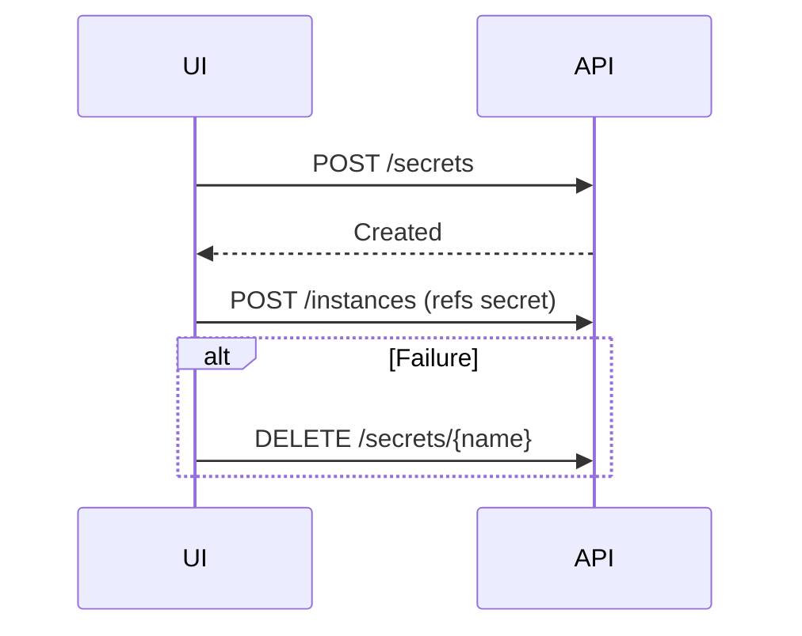

# Secret and ConfigMap Management

*   **Status:** Draft
*   **Authors:** @chilagrow
*   **Created:** 2026-06-30
*   **Last Updated:** 2026-10-26
*   **Related Issues:** https://github.com/openeverest/openeverest/issues/1798, https://github.com/openeverest/openeverest/issues/2471


---

## 1. Summary

This specification introduces namespace-scoped API endpoints for managing Secrets and ConfigMaps used by Instances and its components. Secrets and ConfigMaps created through these endpoints are labeled for identification. Providers customize the creation form fields using UI schema definitions.

## 2. Motivation

Currently, users must create Secrets and ConfigMaps using `kubectl`, breaking the unified management experience. This spec provides:

1. **API endpoints** for Create, Get, Delete operations
2. **Lifecycle management** via labels and owner references
3. **Provider-customizable UI** using the same schema mechanism as Instance creation

## 3. Goals & Non-Goals

**Goals:**
- Provide namespace-scoped API endpoints for Secrets and ConfigMaps
- Support inline creation during Instance creation
- Allow providers to define UI schema for Secrets and ConfigMaps creation forms

**Non-Goals:**
- Cross-namespace Secrets and ConfigMaps sharing
- Secret versioning or audit trails

## 4. Proposed Solution / Design

### 4.1. Managed Secrets and ConfigMaps Labels

Secrets and ConfigMaps created are identified by labels:

```yaml
apiVersion: v1
kind: Secret  # or ConfigMap
metadata:
  name: my-splithorizon-cert
  namespace: default
  labels:
    openeverest.io/managed: "true"                             # Created via OpenEverest API
    openeverest.io/provider: "provider-percona-server-mongodb" # Provider name (same as spec.provider in Instance CR)
    openeverest.io/definition: "splithorizon-tls"                # Resource definition, used for filtering and validation
```

**Label meanings:**
- `openeverest.io/managed: "true"` — Secrets and ConfigMaps created by OpenEverest API
- `openeverest.io/provider` — Provider that uses Secrets and ConfigMaps type
- `openeverest.io/definition` — Matches `Provider.spec.secrets.<definition>`, used for filtering and validation of keys

### 4.2. API Endpoints

#### Secrets

| Method | Endpoint | Description |
|--------|----------|-------------|
| POST | `/clusters/{cluster}/namespaces/{ns}/secrets` | Create secret |
| GET | `/clusters/{cluster}/namespaces/{ns}/secrets` | List secrets (only metadata without content) |
| GET | `/clusters/{cluster}/namespaces/{ns}/secrets/{name}` | Get secret (only metadata data) |
| DELETE | `/clusters/{cluster}/namespaces/{ns}/secrets/{name}` | Delete secret |
| GET | `/clusters/{cluster}/providers/{name}` | Get secret OpenAPI schema and UI schema definitions |

#### ConfigMaps

| Method | Endpoint | Description |
|--------|----------|-------------|
| POST | `/clusters/{cluster}/namespaces/{ns}/config-maps` | Create configmap |
| GET | `/clusters/{cluster}/namespaces/{ns}/config-maps` | List configmaps |
| GET | `/clusters/{cluster}/namespaces/{ns}/config-maps/{name}` | Get configmap (includes data) |
| DELETE | `/clusters/{cluster}/namespaces/{ns}/config-maps/{name}` | Delete configmap |
| GET | `/clusters/{cluster}/providers/{name}` | Get configmap OpenAPI schema and UI schema definitions |

#### `POST /clusters/{cluster}/namespaces/{ns}/secrets`

The request body follows Kubernetes Secret/ConfigMap format with OpenEverest-specific labels.
The labels `openeverest.io/definition` and `openeverest.io/provider` are required.

For creating base64 encoded request:

```json
{
  "apiVersion": "v1",
  "kind": "Secret",
  "metadata": {
    "name": "my-splithorizon-cert",
    "namespace": "default",
    "labels": {
      "openeverest.io/provider": "provider-percona-server-mongodb",
      "openeverest.io/definition": "splithorizon-tls"
    }
  },
  "type": "Opaque",
  "data": {
    "tls.crt": "<base64-encoded>",
    "tls.key": "<base64-encoded>"
  }
}
```

For plaintext request:

```json
{
  "apiVersion": "v1",
  "kind": "Secret",
  "metadata": {
    "name": "my-splithorizon-cert",
    "namespace": "default",
    "labels": {
      "openeverest.io/provider": "provider-percona-server-mongodb",
      "openeverest.io/definition": "splithorizon-tls"
    }
  },
  "type": "Opaque",
  "stringData": {
    "tls.crt": "<plaintext>",
    "tls.key": "<plaintext>"
  }
}
```

If a secret with the same name already exists, the API server return `409 CONFLICT`.

Response strips `data` and `stringData`:
```json
{
  "apiVersion": "v1",
  "kind": "Secret",
  "metadata": {
    "name": "my-splithorizon-cert",
    "namespace": "default",
    "labels": {
      "openeverest.io/managed": "true", // Added by API server
      "openeverest.io/provider": "provider-percona-server-mongodb",
      "openeverest.io/definition": "splithorizon-tls"
    }
  },
  "type": "Opaque",
  // no data or stringData
}
```

#### `GET /clusters/{cluster}/namespaces/{ns}/secrets`

Response strips `data` and `stringData`:

```json
[{
  "apiVersion": "v1",
  "kind": "Secret",
  "metadata": {
    "name": "my-splithorizon-cert",
    "namespace": "default",
    "labels": {
      "openeverest.io/managed": "true",
      "openeverest.io/provider": "provider-percona-server-mongodb",
      "openeverest.io/definition": "splithorizon-tls"
    }
  },
  "type": "Opaque",
  // no data or stringData
}]
```

The response list contains secrets with `"openeverest.io/managed": "true"` label. Also filters the secrets based on the user's `read` RBAC permission on `secrets`.

#### `GET /clusters/{cluster}/namespaces/{ns}/secrets/{name}`

The response is the same as an item of list:

```json
{
  "apiVersion": "v1",
  "kind": "Secret",
  "metadata": {
    "name": "my-splithorizon-cert",
    "namespace": "default",
    "labels": {
      "openeverest.io/managed": "true",
      "openeverest.io/provider": "provider-percona-server-mongodb",
      "openeverest.io/definition": "splithorizon-tls"
    }
  },
  "type": "Opaque",
  // no data or stringData
}
```

If the secret was found, but does not contain the label `"openeverest.io/managed": "true"`, server returns 404.

#### `DELETE /clusters/{cluster}/namespaces/{ns}/secrets/{name}`

On success, returns NO CONTENT 204 with no body.

If the secret was found, but does not contain the label `"openeverest.io/managed": "true"`, it returns 404.

#### `GET /clusters/{cluster}/providers/{name}`

```json
{
  "metadata": {
    "name": "percona-server-mongodb",
  },
  "spec": {
    "componentTypes": { ... },
    "components": { ... },
    "topologies": { ... },
    "versions": [ ... ],
    "uiSchema": {
      "replicaSet": { ... },
      "sharded": { ... },
    },
    "secrets": {
      "splithorizon-tls": {
        "parametersSchema": {
          "openAPIV3Schema": {
            "type": "object",
            "properties": {
              "tls.crt": { "type": "string" },
              "tls.key": { "type": "string" }
            }
          }
        },
        "uiSchema": { 
          // UI schema for split horizon
          "label": "TLS Certificate",
          "componentsOrder": ["tlsCrt", "tlsKey"],
          "components": { ... }
        }
      },
      "user": {
        "parametersSchema": {
          "openAPIV3Schema": { ... }
        },
        "uiSchema": {
          // UI schema for import credentials
        }
      }
    },
    "configMaps": {
      "custom-mongod": {
        "parametersSchema": {
          "openAPIV3Schema": { ... }
        },
        "uiSchema": {
          // UI schema for custom mongod configuration
        }
      }
    }
  }
}
```

**Label examples:**
- Component secret: `"openeverest.io/definition": "splithorizon-tls"`
- Import credential: `"openeverest.io/definition": "user"`

#### Query Parameters (List)

**Filtering:**
- `provider` — Filter by provider name (e.g., `provider=percona-server-mongodb`)
- `definition` — Filter by definition (e.g., `definition=splithorizon-tls`)
  - Can be combined with provider filter

**Examples:**
- `/secrets` — All managed secrets
- `/secrets?provider=percona-server-mongodb` — Provider-specific secrets
- `/secrets?provider=percona-server-mongodb&definition=splithorizon-tls` — Definition within provider
- `/secrets?definition=splithorizon-tls` — Definition across all providers

### 4.3. Instance Creation Flow

When configuring a component that requires a Secret or ConfigMap, the UI displays a dropdown and/or add secret option decided by provider developer.

**Examples:**
- Split horizon: `GET /clusters/{cluster}/namespaces/{ns}/secrets?provider={provider}&definition=splithorizon-tls`
- Import credentials: Show add secret option

The UI shows:
- Existing managed secrets matching the provider and definition (optional)
- Option to "Create New" which opens the creation form

**Inline Creation Flow:**



#### Split Horizon Example

For split horizon, the component will require secret such as `my-splithorizon`.

```
apiVersion: instance.openeverest.io/v1alpha1
kind: Instance
metadata:
  name: my-mongo-cluster
  namespace: production
spec:
  provider: percona-server-mongodb
  components:
    engine:
      ...
    splithorizon:
      parameters:
        secretRef:
          name: my-splithorizon
```

Below is the content of an example of the secret:

```
apiVersion: v1
kind: Secret
metadata:
  name: my-splithorizon
  namespace: production
  labels:
    openeverest.io/provider: percona-server-mongodb
    openeverest.io/definition: splithorizon-tls
type: Opaque
data:
  tls.crt: "<secure-crt>"
  tls.key: "<secure-key>"
```

#### Import Example

For import, instance creation flow require additional steps to populate necessary secrets.

The example secret `my-mongo-cluster-import-creds` is assigned, the secret may be used by more than one Instance.

```
apiVersion: instance.openeverest.io/v1alpha1
kind: Instance
metadata:
  name: my-mongo-cluster
  namespace: production
spec:
  provider: percona-server-mongodb
  topology: replica-set
  components:
    ...

  userSecretRef:
    name: my-mongo-cluster-import-creds
```

Below is the content of an example of the secret:

```
apiVersion: v1
kind: Secret
metadata:
  name: my-mongo-cluster-import-creds
  namespace: production
  labels:
    openeverest.io/provider: percona-server-mongodb
    openeverest.io/definition: user
type: Opaque
data:
  MONGODB_BACKUP_USER: "backup"
  MONGODB_BACKUP_PASSWORD: "<secure-password>"
  MONGODB_CLUSTER_ADMIN_USER: "clusterAdmin"
  MONGODB_CLUSTER_ADMIN_PASSWORD: "<secure-password>"
  MONGODB_CLUSTER_MONITOR_USER: "clusterMonitor"
  MONGODB_CLUSTER_MONITOR_PASSWORD: "<secure-password>"
  MONGODB_DATABASE_ADMIN_USER: "databaseAdmin"
  MONGODB_DATABASE_ADMIN_PASSWORD: "<secure-password>"
  MONGODB_USER_ADMIN_USER: "userAdmin"
  MONGODB_USER_ADMIN_PASSWORD: "<secure-password>"
```

### 4.4. Provider Secret/ConfigMap Definitions

Providers define Secret and ConfigMap types in separate definition files, similar to BackupClass definitions:

#### Definition Structure

```
definition/
  secrets/
    user/
      definition.yaml  # Schema configuration
      ui.yaml          # UI rendering hints
      types.go         # Go types for schema validation
  configmaps/
    custom-mongod/
      definition.yaml  # Schema configuration
      ui.yaml          # UI rendering hints
      types.go         # Go types for schema validation
```

#### Secret Definition

**definition.yaml:**
```yaml
# definition/secrets/user/definition.yaml
parametersSchema:
  openAPIV3Schema: UserSecretData
```

**ui.yaml:**
```yaml
# definition/secrets/user/ui.yaml
label: "User Credentials"
componentsOrder:
  - backupUser
  - backupPassword
  - clusterAdminUser
  - clusterAdminPassword
  - clusterMonitorUser
  - clusterMonitorPassword
  - databaseAdminUser
  - databaseAdminPassword
  - userAdminUser
  - userAdminPassword
components:
  backupUser:
    uiType: text # TODO: use base64 encoded text
    path: "data.MONGODB_BACKUP_USER" # use stringData for text, data for base64 encoded text
    fieldParams:
      label: "Backup User"
    validation:
      required: true
  backupPassword:
    uiType: text # TODO: use base64 encoded text
    path: "data.MONGODB_BACKUP_PASSWORD" # use stringData for text, data for base64 encoded text
    fieldParams:
      label: "Backup Password"
    validation:
      required: true
  clusterAdminUser:
    uiType: text # TODO: use base64 encoded text
    path: "data.MONGODB_CLUSTER_ADMIN_USER" # use stringData for text, data for base64 encoded text
    fieldParams:
      label: "Cluster Admin User"
    validation:
      required: true
  clusterAdminPassword:
    uiType: text # TODO: use base64 encoded text
    path: "data.MONGODB_CLUSTER_ADMIN_PASSWORD" # use stringData for text, data for base64 encoded text
    fieldParams:
      label: "Cluster Admin Password"
    validation:
      required: true
  clusterMonitorUser:
    uiType: text # TODO: use base64 encoded text
    path: "data.MONGODB_CLUSTER_MONITOR_USER" # use stringData for text, data for base64 encoded text
    fieldParams:
      label: "Cluster Monitor User"
    validation:
      required: true
  clusterMonitorPassword:
    uiType: text # TODO: use base64 encoded text
    path: "data.MONGODB_CLUSTER_MONITOR_PASSWORD" # use stringData for text, data for base64 encoded text
    fieldParams:
      label: "Cluster Monitor Password"
    validation:
      required: true
  databaseAdminUser:
    uiType: text # TODO: use base64 encoded text
    path: "data.MONGODB_DATABASE_ADMIN_USER" # use stringData for text, data for base64 encoded text
    fieldParams:
      label: "Database Admin User"
    validation:
      required: true
  databaseAdminPassword:
    uiType: text # TODO: use base64 encoded text
    path: "data.MONGODB_DATABASE_ADMIN_PASSWORD" # use stringData for text, data for base64 encoded text
    fieldParams:
      label: "Database Admin Password"
    validation:
      required: true
  userAdminUser:
    uiType: text # TODO: use base64 encoded text
    path: "data.MONGODB_USER_ADMIN_USER" # use stringData for text, data for base64 encoded text
    fieldParams:
      label: "User Admin User"
    validation:
      required: true
  userAdminPassword:
    uiType: text # TODO: use base64 encoded text
    path: "data.MONGODB_USER_ADMIN_PASSWORD" # use stringData for text, data for base64 encoded text
    fieldParams:
      label: "User Admin Password"
    validation:
      required: true
```

**types.go:**
```go
// definition/secrets/user/types.go
package importcredentials

// ImportCredentialsConfig describes the expected data keys for this secret type.
// +k8s:openapi-gen=true
type ImportCredentialsConfig struct {
    MongoDBBackupUser           string `json:"MONGODB_BACKUP_USER"`
    MongoDBBackupPassword       string `json:"MONGODB_BACKUP_PASSWORD"`
    MongoDBClusterAdminUser     string `json:"MONGODB_CLUSTER_ADMIN_USER"`
    MongoDBClusterAdminPassword string `json:"MONGODB_CLUSTER_ADMIN_PASSWORD"`
    MongoDBClusterMonitorUser     string `json:"MONGODB_CLUSTER_MONITOR_USER"`
    MongoDBClusterMonitorPassword string `json:"MONGODB_CLUSTER_MONITOR_PASSWORD"`
    MongoDBDatabaseAdminUser     string `json:"MONGODB_DATABASE_ADMIN_USER"`
    MongoDBDatabaseAdminPassword string `json:"MONGODB_DATABASE_ADMIN_PASSWORD"`
    MongoDBUserAdminUser          string `json:"MONGODB_USER_ADMIN_USER"`
    MongoDBUserAdminPassword     string `json:"MONGODB_USER_ADMIN_PASSWORD"`
}
```

**provider CR**

The Provider returns OpenAPI schema and UI schema.

```
apiVersion: core.openeverest.io/v1alpha1
kind: Provider
metadata:
  name: percona-server-mongodb
  ...
spec:
  secrets:
    user:
      parametersSchema:
        openAPIV3Schema:
          properties:
            MONGODB_BACKUP_PASSWORD:
              type: string
            MONGODB_BACKUP_USER:
              type: string
            MONGODB_CLUSTER_ADMIN_PASSWORD:
              type: string
            MONGODB_CLUSTER_ADMIN_USER:
              type: string
            MONGODB_CLUSTER_MONITOR_PASSWORD:
              type: string
            MONGODB_CLUSTER_MONITOR_USER:
              type: string
            MONGODB_DATABASE_ADMIN_PASSWORD:
              type: string
            MONGODB_DATABASE_ADMIN_USER:
              type: string
            MONGODB_USER_ADMIN_PASSWORD:
              type: string
            MONGODB_USER_ADMIN_USER:
              type: string
            PMM_SERVER_TOKEN:
              type: string
          type: object
...
```

#### Component UI Schema Reference

Components reference secret definitions.
Below is an example, but final UI schema components will change.

```yaml
# definition/topologies/<topology>/topology.yaml
ui:
  sections:
    configuration:
      label: "Import Configuration"
      components:
        importCredentials:
          uiType: secret # New - may change
          path: spec.dataSource.import.config.credentialsSecretName # New: does not exist yet and may change
          definition: user  # New: References definition/secrets/user
          fieldParams:
            label: "Import Credentials"
            createLabel: "+ Add New Credentials" # New - may change
          dataSource: # Fetch from `GET /secrets?provider=provider-percona-server-mongodb&definition=user`
            # TODO: to match v1 implementation dataSource won't be necessary
          validation:
            required: true
```

**How it works:**
1. Dropdown populated via `GET /secrets?provider=provider-percona-server-mongodb&definition=user`
2. Shows existing secrets matching the definition
3. "Add New" button opens creation modal rendered from `definition/secrets/user/ui.yaml`
4. Schema validation uses `definition/secrets/user/secret.yaml` config

### 4.5. Settings

**Lifecycle Management:**

All Secrets and ConfigMaps are owned by users, Provider will not delete them and persists after individual Instances are deleted.
Finalizers may be set by the providers.

A Settings page is provided in the OpenEverest UI to manage Secrets and ConfigMaps that are no longer needed.

Under Settings, a dedicated management page allows users to view and manage Secrets and ConfigMaps:

**Location:**
- Settings → Secrets
- Settings → ConfigMaps

**Layout:**
- **Tabs**: resources are grouped by:
  1. **Provider** (e.g., "provider-percona-server-mongodb")
  2. **Definition** within each provider (e.g., "splithorizon-tls", "user")

The list view displays each item and following actions: 
- **View**: GET (Secret data is not shown for security)
- **Delete**: DELETE with validation

### 4.6. RBAC

Access to Secret and ConfigMap management endpoints uses Casbin RBAC for authorization:

#### Casbin Policy Model

OpenEverest uses Casbin's RBAC with resource-based access control:
- `secrets` RBAC resource name for Secrets
- `config-maps` RBAC resource name for ConfigMaps

#### Casbin Policies

**Actions:**
- `create` - Create new Secret/ConfigMap
- `read` - List and view metadata
- `delete` - Delete Secret/ConfigMap

**Resource Pattern Format:**
```
{cluster}/{namespace}/{name}
```

**Wildcard Rules:**
- `*` matches any value at that level
- `**` not supported (use explicit wildcards at each level)

**Policy Examples:**
- `p, role:test, secrets, read, prod/*/*` - All secrets in a namespace
- `p, role:test, secrets, read, prod/ns1/*`  - Secrets in specific namespace
- `p, role:test, secrets, read, prod/ns1/secret1`  - Specific secret in specific namespace
- `p, role:test, config-maps, read, prod/*/*` - All ConfigMaps in a namespace

## 5. Definition of Done

- [ ] API endpoints implemented for Secrets (Create, List, Update, Delete)
- [ ] API endpoints implemented for ConfigMaps (Create, List, Get, Delete)
- [ ] Labels applied correctly on Secrets and ConfigMaps creation
- [ ] Management UI in Settings for viewing, updating, and deleting Secrets/ConfigMaps
- [ ] RBAC roles and permissions configured for Secrets and ConfigMaps
- [ ] UI renders forms from provider UI schema
- [ ] Integration tests for API and RBAC

## 6. Alternatives Considered

| Alternative | Decision | Reason |
|-------------|----------|--------|
| Embed secret config in Instance spec | Rejected | No reuse across Instances; large specs |
| Cross-provider shared secrets | Rejected | Adds complexity; each provider must declare identical schemas; fragile if schemas differ between providers; can be revisited if strong use case emerges |

## 7. Open Questions

1. **Secret data in GET:** Should GET return secret data?
   - No, only metadata (use kubectl for data)
2. **Creation of Secrets and ConfigMaps:** Should we allow creation of ConfigMap and Secret in Settings?
   - No for now, this may be requested later.

## 8. References

- https://github.com/openeverest/openeverest/issues/1798
- https://github.com/openeverest/openeverest/issues/2471
