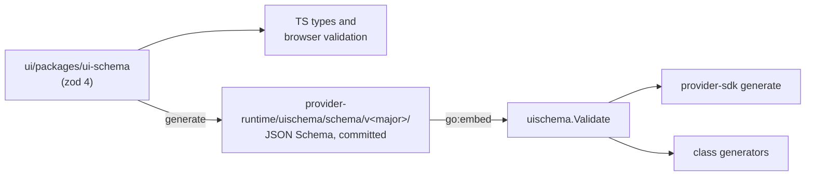

# uiSchema Contract: Ownership, Versioning and Enforcement

*   **Status:** Draft
*   **Authors:** @solovevayaroslavna
*   **Created:** 2026-11-20
*   **Last Updated:** 2026-11-20
*   **Related Issues:** [openeverest#3480](https://github.com/openeverest/openeverest/issues/3480) (this decision), [openeverest#3492](https://github.com/openeverest/openeverest/issues/3492) (epic)
*   **Related specs:** [011 — Secret and ConfigMap Management](./011-secret-configmap-management.md) (its forms are described with a uiSchema)

---

## 1. Summary

A uiSchema describes a form the OpenEverest UI renders. It is produced outside the UI and stored in CRDs, so it is a public contract between provider authors, `provider-sdk`, core and the UI. Today that contract has no single definition, no version, and no structural check outside the browser. This spec defines it once in a UI-owned package that generates a JSON Schema for Go, gives it a `MAJOR.MINOR` version carried in a typed CRD field, checks it at build time and in the browser, and sets the order in which it may change.

## 2. Motivation

A uiSchema is stored in six places:

| # | Field | Forms it holds | Produced by |
|---|-------|----------------|-------------|
| 1 | `Provider.spec.uiSchema` | one per topology | `provider-sdk generate`, from the `ui:` blocks in `definition/topologies/*/` |
| 2 | `Provider.spec.secrets[*].uiSchema` | one form | `provider-sdk generate` |
| 3 | `Provider.spec.configMaps[*].uiSchema` | one form | `provider-sdk generate` |
| 4 | `BackupClass.spec.uiSchema` | by form, e.g. `backup`, `pitr`, `restore` | `provider-sdk generate`, from `definition/backupclasses/*/` |
| 5 | `BackupStorageClass.spec.uiSchema` | `location`, `storage`, `credentials` per auth mode | core, `hack/gen-backupstorageclasses` |
| 6 | `MonitoringClass.spec.uiSchema` | `destination`, `instance`, `credentials` per auth mode | the monitoring backends, written by hand in their charts |

Problems today:

- **No single definition.** The shape is described by hand in the UI types, the schema builder's zod schema, the Go toggleable rules, the SDK path checks and the docs. These drift: `provider-sdk generate` wrote `optionsPathConfig.defaultValuePath` before the UI could read it ([openeverest#3265](https://github.com/openeverest/openeverest/issues/3265)).
- **No version.** A provider cannot say which vocabulary it was built for, and the UI cannot tell a schema that is newer than itself from a broken one.
- **No structural check outside the browser.** `uischema.Validate` in `provider-runtime` checks only the toggleable rules, and only for `Provider.spec.uiSchema`. In the browser an unknown `uiType` renders nothing and passes validation.
- **The vocabulary changes from three sides:** the UI, the SDK and community PRs (`uiType: quantity` in [openeverest#3522](https://github.com/openeverest/openeverest/pull/3522), `gate` in [openeverest#3526](https://github.com/openeverest/openeverest/pull/3526)).

## 3. Goals & Non-Goals

**Goals:**

*   One definition of the uiSchema shape, from which the TS types, the browser check and the Go check all come.
*   A version that tells the UI whether it can render a schema.
*   A schema mistake is caught on the author's machine, at build time.
*   A new prop cannot reach a provider before the UI knows it.
*   An installed provider keeps working after a core upgrade.
*   The update path runs for real before GA, not for the first time after it.

**Non-Goals:**

*   Reporting invalid schemas from core. Deferred, see §4.5.
*   Editor support for provider authors: a JSON Schema for the SDK's `topology.yaml`. To be done once the contract is stable.
*   CEL: where a rule lives (uiSchema `celExpr` or provider Go code) and whether `cel-js` and `cel-go` agree on it.
*   How the UI renders a prop.

## 4. Design

### 4.1 Scope

The contract is the shared vocabulary (field types, `fieldParams`, `validation`, groups, widgets, `modes`), the shape of each of the six envelopes in §2, and the version of both.

Fields the UI adds internally while processing a schema are not part of it.

### 4.2 One Definition, Owned by the UI, with a Generated JSON Schema



- The shape is defined once in a private workspace package of the main repository, `ui/packages/ui-schema` (zod 4). The UI takes its TS types and its runtime validation from it.
- A JSON Schema (draft-07) is generated from the package into `provider-runtime/uischema/schema/v<major>/`, one file per envelope, and committed. Go embeds it.
- The generated files are read-only. CI regenerates them and fails on a diff.
- The package uses only constraints that JSON Schema can express, so TS and Go accept exactly the same documents. Both run the same cases from `provider-runtime/uischema/testdata/`, as they already do for the toggleable rules.
- Rules that JSON Schema cannot express (toggleable today, `gate` later) stay hand-written in Go and TS against shared test data.
- `provider-runtime` is a public SDK: a schema change reaches every provider when it bumps core. A PR that changes the package or the generated schema is treated as an API change and needs approval from one UI and one BE maintainer.

The UI owns the definition because the meaning of a prop is set by the code that renders it, and the UI needs both the types and the runtime check.

### 4.3 Version

- The contract has a version `MAJOR.MINOR`.
  - **Minor:** additive. A new `uiType`, prop or allowed value. Every document that was valid stays valid and keeps its meaning.
  - **Major:** anything else. Removing or renaming a prop, changing its type or its meaning.
- **Before the freeze the major is `0`.** The first version is `0.1`, and every vocabulary change bumps the minor. While the major is `0` a minor bump may also be breaking; the contract changelog marks each bump as additive or breaking. This runs the whole update path before GA: a contract change, the regenerated schema, the version written by the generators and the version check in the UI.
- **`1.0` is the freeze.** It happens before GA, once the vocabulary is settled. `1.0` is the last `0.x` with no changes, and the contract package records which `0.x` that is. From `1.0` on, the minor and major rules above apply strictly.
- The version is declared once, in the contract package, and generated into Go next to the schema, so Go tools read it instead of repeating the number.
- Objects carry it in a typed CRD field, `spec.uiSchemaVersion`, on `Provider`, `BackupClass`, `BackupStorageClass` and `MonitoringClass`.
  - Optional string in the form `MAJOR.MINOR`.
  - One field per object. It covers every uiSchema the object holds; on a `Provider` that is `spec.uiSchema` and the secret and configMap schemas.
  - An absent field means the schema was produced without a version: by an older generator, or by hand. The UI then applies no version rule and validates the schema strictly against its own contract version.
- Authors never write the version. The tool that generates the manifest writes the contract version of the core it is built against.

```yaml
apiVersion: core.openeverest.io/v1alpha1
kind: Provider
spec:
  uiSchemaVersion: "0.1"
  uiSchema:
    replicaSet: { sections: … }
    sharded: { sections: … }
```

### 4.4 Who Writes the Version and Runs the Check

| Producer | Objects | Today |
|----------|---------|-------|
| `provider-sdk generate` | `Provider` (with its secret and configMap schemas), `BackupClass` | Calls `uischema.Validate` for `Provider.spec.uiSchema` only |
| `hack/gen-backupstorageclasses` in core | built-in `BackupStorageClass` | No check |
| The class generator in core, `pkg/classgen` | `MonitoringClass` and other classes built outside the SDK | Renders parameter schemas and validations only; no uiSchema |

Each producer writes `spec.uiSchemaVersion` and fails when `uischema.Validate` reports an issue.

### 4.5 Enforcement and Behaviour on Mismatch

**At build time.** The existing `uischema.Validate` is extended; there is no second entry point.

- It adds a structural check against the embedded JSON Schema: unknown keys, wrong value types, unknown `uiType`.
- It accepts every envelope through new optional `Input` fields, not only the Provider topologies.
- Any issue, structural or behavioural, fails generation.
- In `provider-sdk generate` the check runs after the SDK's own injections, so the SDK cannot emit a prop the contract does not know.

**In the browser.** The UI validates a form's schema when it loads and compares `spec.uiSchemaVersion` with the contract version it was built with.

| Schema version | Behaviour |
|----------------|-----------|
| Same major, minor ≤ UI | Strict validation. A valid schema renders; an invalid one shows an explicit error state for that form. |
| Same major, newer minor | Renders. Unknown props and unknown `uiType`s are ignored, and the form shows a notice to update OpenEverest. |
| Another major | The form is not rendered and shows a clear message. |
| The last `0.x`, on a UI at `1.y` | Treated as `1.0`, because the two are the same vocabulary. A provider installed before the freeze keeps working after the upgrade. |
| No version | Strict validation, no version rule. |

While the major is `0`, a breaking minor shows up in the first row: a schema built for an older `0.x` fails strict validation and gets the error state until the provider is regenerated.

**In core.** No check for now: the generators and the UI catch almost everything. Core never rejects an object because of its uiSchema, so an installed provider keeps working after a core upgrade. If invalid schemas are seen reaching clusters, core reports them with a `UISchemaValid` condition in `status.conditions`, not with an admission webhook or Events ([openeverest#3490](https://github.com/openeverest/openeverest/issues/3490)).

### 4.6 Change Process

Contract first. A new prop or `uiType` lands in one PR: the contract package, the regenerated JSON Schema, the UI implementation, the docs, the shared cases and the version bump. The SDK and providers use it after they bump core.

The build-time check enforces this order: a prop the contract does not know fails generation.

### 4.7 Consequences

- **CRD API.** One new optional field on four kinds. It is public API, so its name is final once released.
- **`provider-runtime`.** Gains a generated directory that UI PRs can change. BE reviews those changes.
- **Providers.** They get the structural check when they bump core. `generate` can start failing on schemas with typos or unknown props, which is intended.
- **`provider-sdk`.** A small change: pass the BackupClass, secret and configMap schemas to `Validate`, and write `spec.uiSchemaVersion`.
- **Class generators.** `pkg/classgen` and `hack/gen-backupstorageclasses` need to write the version and run the check. Neither handles a uiSchema today.
- **UI.** A form with an invalid schema shows an error state instead of a partial form. This is user-visible and needs a UX review.

## 5. Definition of Done

*   The contract package exists and the UI takes its schema types from it ([openeverest#3483](https://github.com/openeverest/openeverest/issues/3483), [openeverest#3486](https://github.com/openeverest/openeverest/issues/3486), [openeverest#3487](https://github.com/openeverest/openeverest/issues/3487)).
*   The JSON Schema is generated into `provider-runtime`, CI fails on a diff, and `uischema.Validate` runs the structural check for every envelope ([openeverest#3485](https://github.com/openeverest/openeverest/issues/3485)).
*   `spec.uiSchemaVersion` exists on `Provider`, `BackupClass`, `BackupStorageClass` and `MonitoringClass` (no issue yet).
*   `provider-sdk generate` validates every schema it assembles and writes the version ([openeverest#3489](https://github.com/openeverest/openeverest/issues/3489)).
*   The class generators write the version and run the check (no issue yet).
*   The UI validates schemas in the browser and applies the version rules of §4.5 ([openeverest#3488](https://github.com/openeverest/openeverest/issues/3488)).
*   The contract is frozen as `1.0` before GA.
*   The docs for provider authors describe the version, the compatibility rules and the change process, and a contract changelog exists ([openeverest#3491](https://github.com/openeverest/openeverest/issues/3491)).

## 6. Alternatives Considered

| Alternative | Why not |
|-------------|---------|
| Staying at `1.0` before GA, with changes that do not bump it | The update path would run for the first time after GA. |
| A pre-release suffix before GA, e.g. `1.0-dev.3` | Needs a third component and pre-release ordering in both Go and TS. `0.x` says the same in the `MAJOR.MINOR` form. |
| A reserved `schemaVersion` key inside `uiSchema` | Clashes with topology and form names, is untyped and is not visible in `kubectl`. |
| JSON Schema or Go types as the hand-written source | The UI would still need hand-written types and a runtime check, which is the duplication this spec removes. |
| A separate Go entry point for the structural check | `provider-sdk generate` already calls `uischema.Validate` and fails on its issues; one entry point means a core bump is enough to get new checks. |
| Rejecting an invalid uiSchema at admission | An installed provider could stop working after a core upgrade, and a webhook outage would block provider installs. |

## 7. Open Questions

1.  **Field name.** Is `spec.uiSchemaVersion` final? It is one field per object; on a `Provider` it also covers the secret and configMap schemas.
2.  **`BackupStorageClass`.** It got a `spec.uiSchema` in [openeverest#3508](https://github.com/openeverest/openeverest/pull/3508), after the questions in [openeverest#3480](https://github.com/openeverest/openeverest/issues/3480) were written. Is it right to treat it as a sixth envelope, with `hack/gen-backupstorageclasses` writing the version and running the check?
3.  **`MonitoringClass` through `pkg/classgen`.** classgen renders parameter schemas and validations only, and the `MonitoringClass` uiSchema is written by hand in the backend's chart (e.g. `charts/monitoring-pmm/templates/monitoringclass.yaml`). What should the check look like there: a classgen command that validates the uiSchema and prints the version for the chart?
4.  **Older core.** When a manifest that sets `spec.uiSchemaVersion` is installed on a core whose CRD does not have the field yet, is the field dropped or is the install rejected? §4.3 accepts an object without the field, so it needs to be dropped.

## 8. References

*   [Proposal](https://github.com/openeverest/openeverest/issues/3480#issuecomment-6848813928) and [BE reply](https://github.com/openeverest/openeverest/issues/3480#issuecomment-6918257307) in openeverest#3480.
*   [`provider-runtime/uischema`](https://github.com/openeverest/openeverest/tree/main/provider-runtime/uischema): the Go validator and the test cases it shares with the UI.
*   [UI Generator architecture docs](https://github.com/openeverest/openeverest/tree/main/docs/ui/architecture/ui-generator) and the [schema authoring guide](https://github.com/openeverest/openeverest/tree/main/docs/ui/ui-generator).
*   [openeverest#3555](https://github.com/openeverest/openeverest/pull/3555): the shared class generator, `pkg/classgen`.
